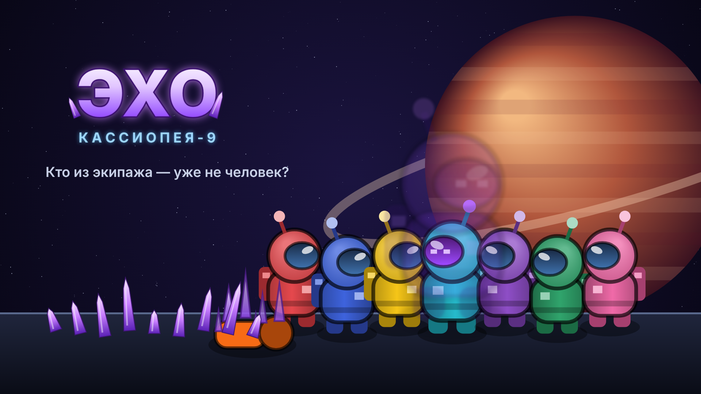

# ЭХО: Кассиопея-9

Социальная детективная игра в духе «Among Us» со своим сюжетом, персонажами и картой.
Работает прямо в браузере — ничего устанавливать не нужно.

## Как запустить
1. Распакуйте архив.
2. Откройте `index.html` двойным кликом (Chrome, Edge, Firefox, Яндекс.Браузер).

Игра работает и без интернета. На телефоне/планшете есть сенсорный джойстик и кнопки.

## Сюжет
2189 год. Добывающая станция «Кассиопея-9» висит над газовым гигантом Тифон. Буровой зонд поднял
из облаков кристалл «Эхо», который умеет копировать людей целиком — голос, походку, память, — а оригинал
превращается в груду звенящих кристаллов. Связь с Землёй оборвалась, и среди смотрителей станции уже есть копии.

* **Смотрители** чинят станцию, чтобы отправить сигнал бедствия, и вычисляют Эхо на собраниях.
* **Эхо** притворяются людьми, кристаллизуют смотрителей, саботируют станцию и ждут спасательный корабль,
  который отвезёт их на Землю.

## Что есть в игре
* Карта станции: 9 отсеков (реактор, двигатели, медотсек, кают-компания, лаборатория, склад, оранжерея,
  связь, мостик), коридоры, 3 сети вентиляции, туман войны с честной линией обзора.
* 9 мини-игр заданий: проводка, код доступа, заправка, разгрузка, передача данных, стабилизация ядра,
  настройка антенны, сбор спор, биоскан (его видят другие — доказательство, что ты человек).
* Роль Смотрителя и роль Эхо: убийство с перезарядкой, вентиляция, 3 вида саботажа
  (свет, перегрузка реактора с таймером, глушение связи) и мини-игры для их устранения.
* Боты с ИИ: ходят по станции по поиску пути, делают задания, замечают тела, свидетельствуют убийства и
  вентиляцию, запоминают, кого где видели. Боты-Эхо выслеживают одиночек, прячутся в вентиляции,
  саботируют и врут на собраниях.
* Собрания: тело или экстренная кнопка, чат с репликами ботов (алиби, обвинения, оправдания),
  твои сообщения влияют на подозрения ботов, голосование, пропуск, ничья, сцена изгнания в космос.
* 4 концовки, экран ролей, процедурный звук (без внешних файлов), настройки партии
  (4–9 ботов, 1–3 Эхо, перезарядка, время собрания, число заданий, роль, сложность, громкость).

## Управление
| Клавиша | Действие |
|---|---|
| WASD / стрелки | движение |
| E / Enter | действие (задание, кнопка, починка, вентиляция) |
| R | сообщить о теле |
| Q | кристаллизовать (Эхо) |
| F | меню саботажа (Эхо) |
| 1, 2 | перемещение по вентиляции |
| M / Tab | карта |
| Esc | закрыть окно |

## Файлы
* `index.html`, `style.css`, `js/` — игра (чистый JavaScript + Canvas, без библиотек).
* `assets/` — иконки (`icon-32/192/256/512.png`), логотип, баннеры (`banner.png` 1920×1080, `banner-wide.png` 1280×640).
* `tools/assets.html` + `tools/make_assets.js` — генератор иконки и баннера из игровой графики
  (`node tools/make_assets.js`, нужен Playwright).
