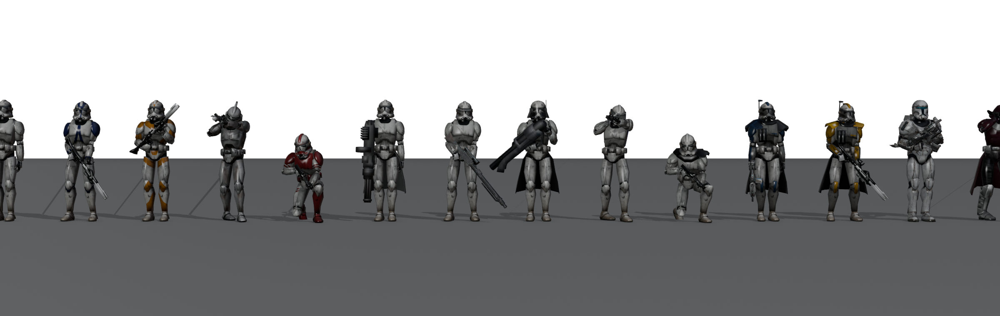
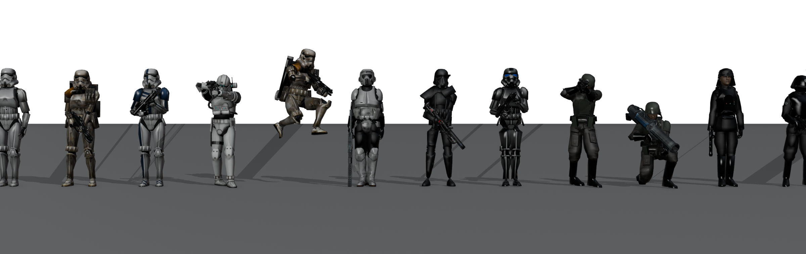

# Star Wars: Командир клонов

Тактический шутер с управлением армией (не RTS в чистом виде). Вы — командир клонов от третьего лица, как в
Star Wars Battlefront. Рядом ваша армия: набираете бойцов, собираете отряды и задаёте им строй, стойку,
походку и правила огня. На карте 1,6 × 1,6 км Империя держит аванпосты с турелями и крепость с командным
центром под щитом. Цель — уничтожить генераторы щита и командный центр.

> Некоммерческий фан-проект. «Звёздные войны» принадлежат Lucasfilm/Disney. Модели бойцов и оружия берутся
> из аддонов Garry's Mod (Steam Workshop) и конвертируются **у вас на компьютере**; в репозиторий они не
> попадают, потому что лицензия у их авторов. Без них игра работает на моделях v2 из этого репозитория.




## Быстрый старт
1. **Модели из Workshop** (один раз). Нужны Node.js 18+ и Python 3.11 с `pip install bpy==4.5.* numpy pillow`.
   Команда скачает аддоны, распакует их и сконвертирует:
   ```
   python Tools/SourceImport/run_import.py
   ```
   В итоге появятся `Assets/_Project/Art/Workshop/` (26 бойцов с анимациями, техника, турели, 208 звуков).
   Если у вас уже есть архив с готовой папкой `Workshop`, просто распакуйте его в `Assets/_Project/Art/`.
2. Откройте проект в **Unity 6 (6000.0.x)** (Unity Hub → Add → папка проекта). Пакет Steamworks.NET уже лежит в `Packages/`, Git не нужен.
3. При первом открытии всё соберётся само. Вручную: **Star Wars → Командир клонов → Собрать игру (всё)**.
   Сборщик создаёт каталог юнитов, материалы, префабы, карту (рельеф, леса, аванпосты, NavMesh) и сцены `Menu` и `Battle`.
   Первый импорт моделей и запекание NavMesh займут несколько минут.
4. Нажмите **Play**: игра всегда стартует с меню.

## Армия: строи, стойки, походки
| | Варианты |
|---|---|
| **Строй** (Q) | шеренга, две шеренги, колонна, колонна по двое, клин, обратный клин, ромб, каре, круговая оборона, уступ влево/вправо, рассыпной; интервал 1–6 м |
| **Стойка** (E) | боевая (оружие у плеча), на изготовку, «вольно», «смирно», на колене, лёжа |
| **Походка** (X) | шагом, тактический шаг (стреляют на ходу), патрульный, **строевой** (весь отряд идёт в ногу), бегом, пригнувшись |
| **Правила огня** (V) | огонь по готовности, только ответный, не стрелять |
| **Приказы** | стоять, выдвинуться, за мной, атаковать район, захватить пункт, оборонять (бойцы занимают укрытия) |

В бою «смирно» и «вольно» сами сменяются на боевую стойку, строевой шаг — на тактический. Отряд держит строй
по пути NavMesh, ждёт отстающих, а отставшие догоняют бегом.

## Управление
Основной вид — **RTS-камера** над полем боя. Командира можно «надеть» по Tab и воевать от третьего лица.

**Камера и приказы (RTS)**
| Клавиша | Действие |
|---|---|
| WASD / стрелки / мышь у края экрана | сдвиг камеры (Shift — быстрее) |
| Колесо | приближение от 12 до 320 м; вблизи камера опускается к горизонту |
| Q / E, средняя кнопка мыши | поворот камеры |
| Пробел / Home | к выбранным отрядам / к командиру |
| ЛКМ, рамка ЛКМ, Shift | выбрать отряд, несколько отрядов, добавить к выбору |
| 1–9, ` или 0 | выбрать отряд по номеру, все отряды |
| ПКМ по земле | выдвинуться; протянуть ПКМ — задать направление строя |
| ПКМ по врагу или постройке / по командному пункту | атаковать / захватить |
| Ctrl+ПКМ, Alt+ПКМ | оборонять, атаковать район |
| F, T, Y, H, G | выдвинуться, атаковать, оборонять (в точку под курсором), стоять, ко мне (к командиру) |
| V | правила огня |
| Нижняя панель | строй, стойка, походка, правила огня кнопками |
| B | казарма: набор бойцов, отряды, перевод между отрядами, имена и цвета |
| Tab | вселиться в командира и обратно (если он погиб — экран высадки) |

**Командир (от третьего лица, после Tab)**
| Клавиша | Действие |
|---|---|
| WASD, Shift | движение, бег |
| ПКМ / ЛКМ | прицел / огонь |
| R, G | перезарядка, термальный детонатор |
| C (Ctrl), Z | присесть, лечь |
| F / F дважды, T, H | отрядам: выдвинуться к прицелу / за мной, атаковать, стоять |
| Q / E / X (удерживать) | радиальные меню строя / стойки / походки |
| Enter, Esc, F1 | чат, пауза, справка |

## Бойцы
**Республика:** клон-штурмовик (фаза II), 501-й, 212-й, фаза I, шоковый, тяжёлый (Z-6), снайпер (DC-15x),
ракетчик (RPS-6), инженер, лейтенант, ARC, коммандос, морпех; ваш аватар — командир клонов ARC.
**Империя:** штурмовик, капитан, командир, тяжёлый (DLT-19), шоковый, разведчик, штурмовик смерти, теневой,
армейский солдат, ракетчик, офицер, инженер.

Каждый боец конвертируется со своим оружием (DC-15A, DC-15S, DC-17m, E-11, E-11D, DLT-19 и другие) и получает
скелет v2 и все клипы: бой (стрельба, перезарядка, стрейфы, 6 смертей с рэгдоллом) и строевые клипы
(смирно, вольно, на грудь, строевой шаг, патруль, пригнувшись, лёжа, жесты «вперёд», «стой», отдание чести).
Анимации запекаются процедурным IK-ригом прямо на модель, поэтому руки держат именно это оружие.

## Карта «Феллусия»
- На юге база Республики: посадочные площадки, бункеры, AT-TE, турели.
- В центре 7 аванпостов Империи: стены с проломом, ворота, башни, бункер, турели, часовые «смирно» у ворот,
  патрули по периметру, отряды обороны. Протяжённость фронта в настройках: 3, 5 или 7 аванпостов.
- На севере крепость Империи: стены, 4 башни, AT-AT, командный центр под куполом щита и 2 генератора щита.
- Командные пункты захватываются присутствием бойцов, как в Battlefront. Захваченный пункт даёт снабжение и
  становится точкой высадки подкреплений и командира.
- ИИ Империи держит гарнизоны, отвечает на атаки подкреплениями, отбивает потерянные пункты, а на сложности
  «ветеран» и выше сам переходит в наступление. Подкрепления Империи ограничены тикетами.
- **Победа:** уничтожить командный центр. Генераторы и центр почти не берут бластеры; нужны ракеты и детонаторы.
  **Поражение:** Империя захватила базу Республики.

## Мультиплеер
Устроен как в YourFinalOrder: Steamworks.NET, лобби Steam, P2P через релеи Valve (порты открывать не нужно)
и запасной вариант по IP (LiteNetLib, UDP 7777).
- **Создать лобби:** название; доступ (открытое — видно в списке игр, только друзья, по приглашению);
  2–8 игроков; режим (кооператив или можно играть за Империю); настройки боя.
- **Найти игру:** браузер открытых лобби (название, хост, фронт, сложность, игроки).
- **По коду** и **по IP**.
- **Лобби:** аватары Steam, сторона (Республика или Империя), готовность, пинг, чат, исключение игроков,
  «Пригласить друзей» (оверлей Steam), «Копировать код». Хост начинает бой, когда все готовы.
  Можно войти в уже идущий бой.
- Сервер — хост. ИИ, урон, захват и экономия считаются у него; клиентам уходят сжатые снимки бойцов
  (10 Гц) и события (выстрелы, смерти, отряды, цели). Свой командир у клиента двигается без задержки.

Пока нет своего App ID, используется тестовый **480 (Spacewar)** из `steam_appid.txt`. Ограничения те же, что в
[YourFinalOrder](https://github.com/german122lol44466-max/YourFinalOrder/blob/main/docs/STEAM.md): друг сначала
запускает игру, потом принимает приглашение.

## Устройство кода
```
Assets/_Project/Commander/
  Scripts/Net/      протокол (NetBuffer), транспорты Steam P2P и LiteNetLib, сессия и лобби, Steam (лобби, аватары)
  Scripts/Game/     бойцы (Soldier, SoldierBrain), отряды (Squad, Formations), болты, командные пункты, турели,
                    постройки, ИИ Империи, BattleNet (сервер/клиент), каталог, звук
  Scripts/Player/   командир (CommanderController, камера), приказы (CommandInput), тактическая карта, ввод
  Scripts/UI/       UI Toolkit: меню и лобби, HUD, казарма, высадка, пауза, итоги
  Scripts/World/    постобработка (bloom, ACES, цвет), время суток, NavMesh, меню-сцена
  Editor/           импорт моделей из аддонов, генератор карты, сборщик игры
  Art/Environment/  процедурные постройки, деревья, скалы и текстуры (Tools/Blender/build_environment.py, CC0)
  Resources/Commander/  шрифты (OFL: Play, Russo One), стиль интерфейса (USS), шейдер постобработки
Assets/_Project/Plugins/LiteNetLib/   сетевой UDP (MIT)
Tools/SourceImport/  скачивание из Workshop, распаковка .gma, чтение MDL/VVD/VTX/VTF/VMT, конвертация в FBX
Tools/Blender/swlib/anims3.py        строевые клипы
```

Конвертер моделей Source написан с нуля (`srcfmt.py`: MDL v44–49, VVD с фиксапами, VTX dx90, VTF DXT1/3/5 и
несжатые форматы, VMT с patch-материалами), без сторонних аддонов Blender.

## Что проверено
Unity в этой среде не запускался. Весь C# компилируется против эталонных сборок Unity, в двух вариантах ввода:
старый Input Manager и Input System. Модели, анимации, портреты и постройки сконвертированы и просмотрены в рендерах.
Сцены, префабы, NavMesh и карта собираются у вас при первом открытии проекта. Если что-то пойдёт не так,
пришлите лог консоли Unity.
